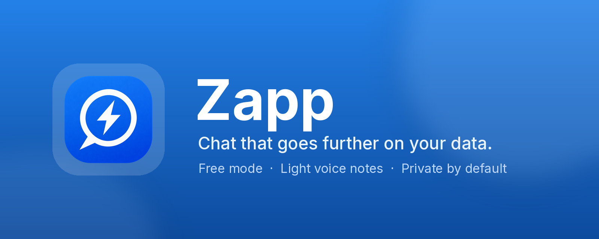

 

  

  

**You're here because Ndivho sent you a link. Thank you for trying Zapp before anyone else does.**

A chat app for the way we actually live: data that runs out before the month does, and chats that should stay between the people in them.

 

## ✨ What it does for you

<table>
<tr>
<td width="50%" valign="top">

### 📶 Your data goes further
Switch on **Free mode** and photos, voice notes and files up to 5 MB travel as chat messages instead of downloads. If your network gives you free chat, they cost you nothing. While you're on it, the people you chat with send you things that way too.

</td>
<td width="50%" valign="top">

### 🎙️ Voice notes that weigh less
About a third of the size they used to be, and the silence before you start talking is cut off. You hear the person, not the pause.

</td>
</tr>
<tr>
<td width="50%" valign="top">

### 🖼️ Photos stay sharp
Zapp only makes a photo smaller when it has to, and then gently. What you send is what they see.

</td>
<td width="50%" valign="top">

### 🔒 Your chats stay yours
Messages are encrypted from your phone to theirs. If someone screenshots your chat, you see a small note saying so.

</td>
</tr>
</table>

 

## 📲 Get it on your phone in four taps

| | |
|:-:|:--|
| **1** | Tap **[Download Zapp](https://github.com/techbyndivho/zapp-releases/releases/download/v5-2.3.0/zapp-v5-2.3.0-universal.apk)** (best on Wi-Fi) |
| **2** | When it finishes, tap the file to open it |
| **3** | If your phone asks, allow your browser to **install unknown apps**. It asks because Zapp isn't on the Play Store yet |
| **4** | Tap **Install**, open Zapp and sign in |

> [!TIP]
> You only do this once. When there's a new version, Zapp tells you inside the app and installs it with one tap.

> [!NOTE]
> Had a test version from Ndivho before? Uninstall it first, then install this one.

 

## 💬 Questions you might have

<b>Is it safe to install?</b>

 
Every version is signed with Ndivho's own key. Before Zapp installs any update, it checks that signature and the file's fingerprint. If anything doesn't match, it refuses.

<b>Why is the download so big?</b>

 
One file works on every Android phone, so it carries what every phone needs. Updates come through the app, so this is the only big download you do by hand.

<b>What is Free mode, really?</b>

 
Some networks count chat as free but charge for downloads. Free mode packs photos, voice notes and files into chat messages, so they travel the free way. Turn it on in <b>Settings → Attachments</b>.

 

### 🙌 Tell Ndivho what you think

This is the first version going to people, and your honest reaction shapes the next one. 
What confused you? What felt slow? What made you smile? Send him a message, even a short one.

 

Zapp 2.3.0 · made in South Africa

